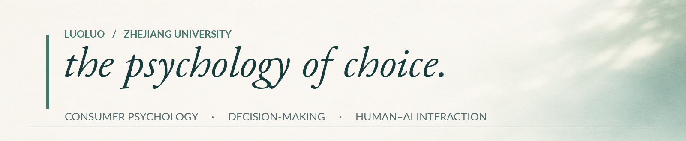

  

I'm **luoluo**, a psychology student at **Zhejiang University**. I'm curious about how people form judgments, navigate uncertainty, and make everyday choices.

I enjoy exploring these questions through **behavioral experiments, data, and interactive design**.

### Research interests

Consumer psychology · Decision-making · Human–AI interaction · Behavioral experiments

---

### Things I'm building

**[Tianyuan Xinshi](https://github.com/luoluo926/tianyuan-xinshi)** — *Deployed*  
An independent project exploring psychology and AI through interactive emotional well-being experiences.

**[Sheng Guan Tu](https://github.com/luoluo926/sheng-guan-tu)** — *In development*  
A browser-based board and card game I'm building for fun.

---

### Contact

[3240100942@zju.edu.cn](mailto:3240100942@zju.edu.cn)
