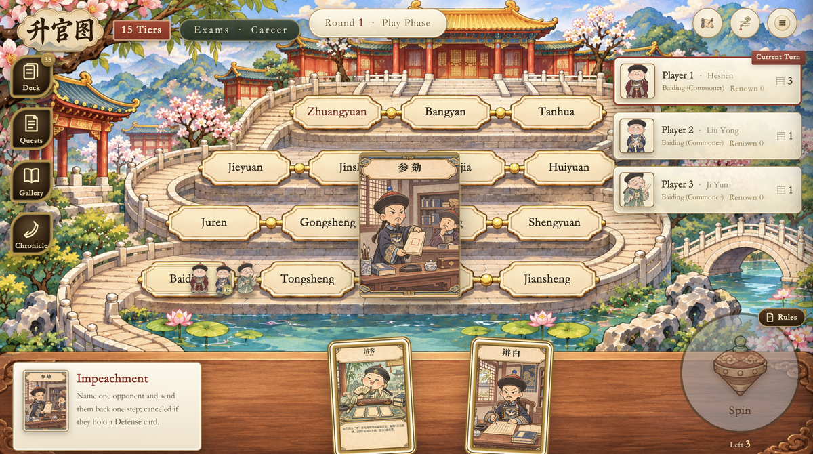
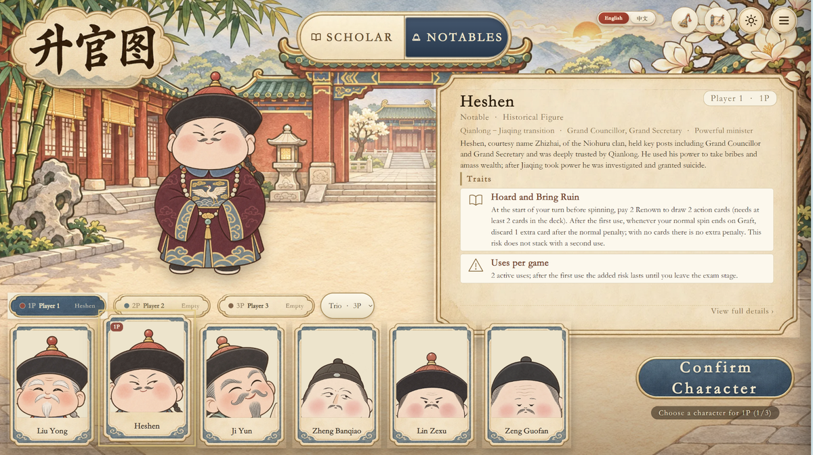
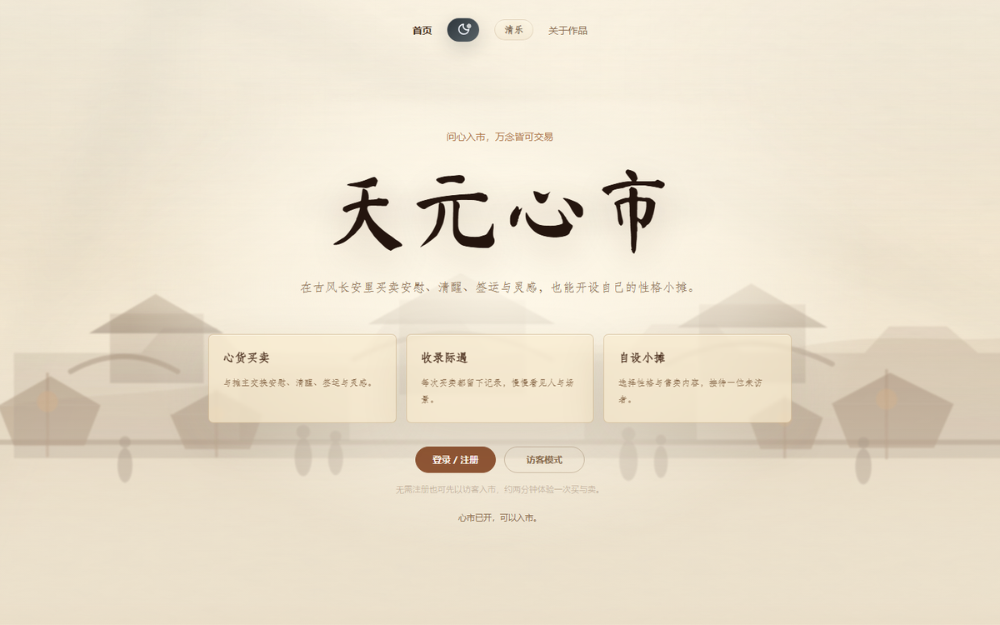
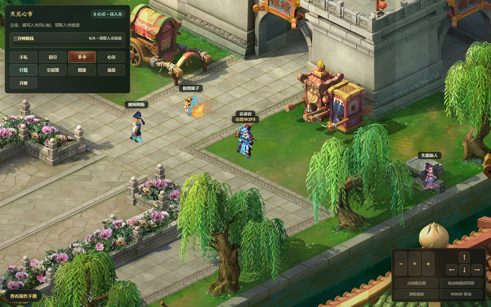

### About

I'm **luoluo**, a psychology student at **Zhejiang University**, working on **consumer psychology**, **decision-making**, and **human–AI interaction**.

I'm curious about the beliefs and uncertainties behind everyday choices. Most of my work is behavioral experiments; some of it turns into small games.

### Research interests

Consumer behavior &nbsp;·&nbsp; Judgment and decision-making &nbsp;·&nbsp; Human–AI interaction

### Find me

[Personal site](https://luoluo926.github.io/) &nbsp;·&nbsp; [Email](mailto:3240100942@zju.edu.cn) &nbsp;·&nbsp; [GitHub](https://github.com/luoluo926)

### Selected projects

**Sheng Guan Tu · Records of Eminent Officials** — *browser board game*  
A rebuild of the Ming–Qing promotion chart, with character roles, action cards and a four-sided judgment top. Runs in Chinese and English.

[Play](https://luoluo926.github.io/sheng-guan-tu/) &nbsp;·&nbsp; [Source](https://github.com/luoluo926/sheng-guan-tu)

  
  

**Tianyuan Xinshi** — *browser market game*  
A market in old Chang'an where comfort, clarity, fortune and inspiration are traded. Built on a Lua engine and delivered to the browser through a small Node runtime.

[Play](https://tiany-heart-market.onrender.com/) &nbsp;·&nbsp; [Source](https://github.com/luoluo926/tianyuan-xinshi) &nbsp;·&nbsp; [Project page](https://luoluo926.github.io/projects/tianyuan/)

  
  

